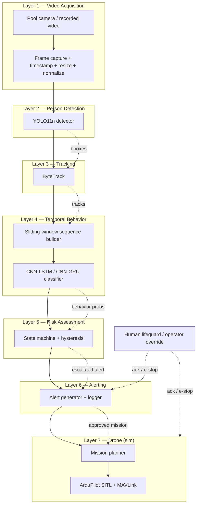
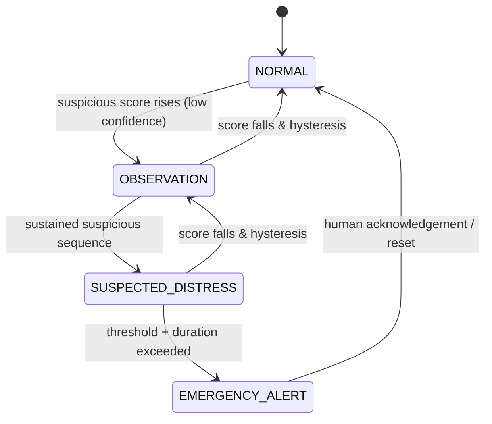
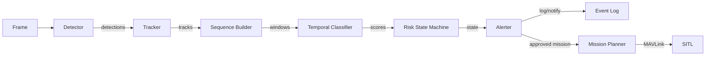
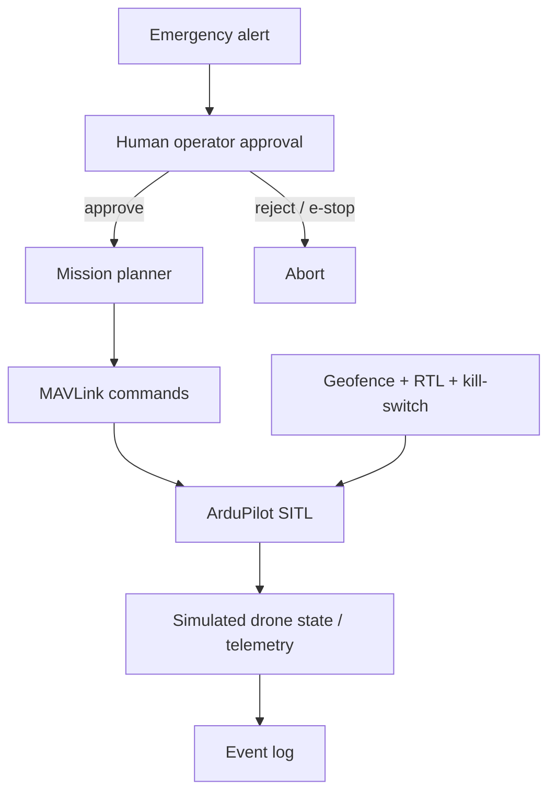

# SYSTEM ARCHITECTURE — Autonomous AI Lifeguard System for Swimming Pools

Document version: 1.0 (draft)  
Date: 2026-11-02  
Status: **Architecture and technical blueprint only — NOT implemented.**

---

## 1. Executive Summary

The project is an **AI-assisted autonomous lifeguard system for swimming pools**. The system ingests pool video, detects people, tracks them across frames, analyzes their behavior over time, and raises escalating alerts for suspected drowning/distress. An optional autonomous drone-assisted response is simulated (not deployed in the real world).

The system is explicitly a **decision-support and rescue-assistance system**. It is **not** a replacement for human lifeguards, and it must never authorize an unsafe physical action from an unverified machine prediction.

The architecture is intentionally simple and modular:

```
Video → Person Detection (YOLO11n) → Tracking (ByteTrack) → Temporal Behavior Analysis
      → Risk Assessment (state machine) → Alerting → (optional) Drone Simulation
```

Key design principles:

- **A person detection is not drowning detection.** Drowning is a temporal event; the detection stage only localizes people.
- **Pool-only scope.** Beach/open-water datasets (SeaDronesSee, MOBDrone) are historical and excluded from active training.
- **Fit the hardware.** NVIDIA GTX 1650 (4 GB VRAM) and 16 GB RAM constrain model size and batch size.
- **Baseline first.** Start with YOLO11n + ByteTrack + a simple temporal classifier; add complexity only when validation justifies it.

---

## 2. Project Scope and Requirements

### 2.1 In scope

- Swimming-pool monitoring (indoor/outdoor pools).
- Person detection inside/near the pool.
- Multi-object tracking of detected people.
- Temporal behavior analysis to distinguish normal swimming/playing/diving/floating from possible distress/drowning.
- Risk assessment with a human-readable state (NORMAL → OBSERVATION → SUSPECTED_DISTRESS → EMERGENCY_ALERT).
- Alert generation and logging.
- Autonomous drone-assisted rescue **simulation** (ArduPilot SITL + MAVLink).

### 2.2 Out of scope

- Beach and open-water surveillance.
- Real-world flight of a physical drone.
- A system that claims to *prove* drowning from a single frame.
- Replacing human lifeguards.

### 2.3 Functional requirements

| ID | Requirement |
|---|---|
| FR-1 | Accept live camera frames or recorded video at configurable resolution/FPS. |
| FR-2 | Detect persons with bounding boxes and confidence scores. |
| FR-3 | Maintain per-person track IDs across frames. |
| FR-4 | Build sliding-window temporal sequences per track. |
| FR-5 | Classify each active track's behavior state (normal / suspicious / distress-like). |
| FR-6 | Fuse detection, tracking, and temporal evidence into a risk state with hysteresis. |
| FR-7 | Generate an alert with timestamp, camera, track ID, snapshot, and confidence. |
| FR-8 | Support alert acknowledgement and event logging. |
| FR-9 | (Simulation) Convert a confirmed alert into a drone mission command with human override. |

### 2.4 Non-functional requirements

| ID | Requirement |
|---|---|
| NFR-1 | Run inference on a single GTX 1650 (4 GB VRAM) without exhausting memory. |
| NFR-2 | End-to-end frame processing should target near-real-time (see PENDING VALIDATION for thresholds). |
| NFR-3 | The system must degrade gracefully on poor lighting, reflections, occlusion, and dropped frames. |
| NFR-4 | Every alert must be traceable to the evidence (track, frames, scores, timestamps). |
| NFR-5 | No destructive or irreversible action may be triggered automatically by the AI. |

---

## 3. System Objectives and Non-Functional Requirements

**Primary objective:** reduce the time from the onset of a real distress event to lifeguard notification, while keeping false alarms low enough to be trusted.

**Secondary objectives:**

- Correctly separate normal swimming/playing/diving/floating from distress.
- Provide a stable, auditable decision trail.
- Demonstrate a complete, testable system as an undergraduate project.

**Non-functional priorities:**

- **Safety > recall > precision.** For a lifeguard aid, missing a real drowning is more harmful than a few false alarms; however, excessive false alarms destroy operator trust. Both must be measured.
- **Latency** matters (early alerting), but it must not be achieved by sacrificing temporal evidence.
- **Resource budget** (GTX 1650 / 16 GB RAM) is a hard constraint.

---

## 4. Current Project Status

Status labels: **VERIFIED**, **PROPOSED**, **PENDING VALIDATION**, **UNKNOWN**.

### 4.1 Verified from repository evidence

- **Hardware target (stated):** Windows 10 Pro, Intel i7-9750H, 16 GB RAM, GTX 1650 4 GB VRAM, Python 3.11, PyTorch + CUDA, Ultralytics YOLO. (Context-provided; not re-verified on the machine.)
- **Existing code:** `scripts/` contains a read-only dataset pipeline (`01_dataset_audit.py` … `06_visualize_annotations.py`, `common.py`, `config.yaml`, `run_pipeline.py`, `train_yolo11n_30ep.py`). `src/` exists but is **empty**.
- **Aerial baseline (historical, out of current pool scope):** `runs/detect/seadrones_yolo11n_30ep_v1/` — YOLO11n trained on **SeaDronesSee ODv2** for 30 epochs (batch 4, imgsz 640, device 0). Final epoch 30 metrics: precision 0.8396, recall 0.6438, **mAP50 0.6654**, **mAP50-95 0.3729**. Per-class validation (`reports/model_evaluation/yolo11n_validation_metrics.csv`) shows a severe failure on `life_saving_appliances` (P 1.0, R 0.0, mAP50 0.0998) and weak `swimmer` mAP50 0.5769.
- **No pool-trained detector exists yet.** The only trained detector is the aerial SeaDronesSee baseline.
- **No tracking, temporal, risk, alert, or drone code exists.** These are all PROPOSED.
- **Z5cc is Google-Drive-hosted.** Verified paths in `notebooks/z5cc_dataset_preparation.py`:
  - Source: `/content/drive/MyDrive/lifeguard_test`
  - Prepared output: `/content/drive/MyDrive/lifeguard_datasets/Z5cc_v1`
  - The prepared dataset is documented (from prior outputs) as ~48,072 images/labels, 2 classes `swim`/`drown`, video-level train/val/test splits. This is **PENDING VALIDATION** until the Drive dataset is re-accessed and its current state confirmed.
- **DrowningDetectionTracking_v1 audit:** full read-only audit completed in `DrowningDetectionTracking_v1_audit_results/`. Verified: 23,586 images/labels; 49,040 valid boxes; 15 malformed lines (15 files, 6 only-invalid); 1 empty test label; 67 large (>90% area) boxes; 99 exact cross-split image hash groups (365 files); 173 exact label hash groups (702 files); 685 same-source-prefix groups (12,667 files); 7-class mixed schema (numeric 0–3 undocumented, semantic `Out of Water`/`drowning`/`swimming`); `data.yaml` missing; `data.fixed.yaml` has an invalid absolute path. Verdict: **CLEAN AND RE-EVALUATE**.
- **Scene classification in progress:** `DrowningDetection_v1_cleaning/02_pool_only_filtering.ipynb` + `scene_classification_manifest.csv`. Only **3 images classified** so far (23,583 unclassified). Classes 0–3 meanings remain **UNKNOWN**.
- **Hugging Face model assessed:** `Bagsangbin/yolo8s-drowning-detection` → **REJECT** (undocumented, unknown classes/dataset/metrics, AGPL-3.0). See `huggingface_yolov8s_drowning_model_assessment.md`.

### 4.2 Contradictions / ambiguities to preserve

- The **only trained detector is aerial** (SeaDronesSee), while the **current scope is pool-only**. Do not silently treat the SeaDronesSee model as the pool baseline.
- Z5cc is the intended primary temporal dataset, but its current Drive accessibility and exact clip/FPS/label statistics are **UNKNOWN** from the local repository alone and must be re-validated in Colab.
- The DrowningDetectionTracking public page documents **3** semantic classes; the local export declares **7** (with numeric placeholders). This contradiction is unresolved.

---

## 5. Overall System Architecture



---

## 6. Detailed Component Architecture

### Layer 1 — Video Acquisition

- **Inputs:** live RTSP/USB camera stream or recorded `.mp4`.
- **Responsibilities:** capture, timestamp, decode, resize (e.g., 640×640), normalize, and feed frames downstream.
- **Camera placement:** poolside/CCTV overhead or side view. Final hardware and field-of-view are **UNKNOWN** and are a supervisor-confirmation item.
- **Robustness:** handle reflections, lighting change, occlusion, blur; graceful degradation if a frame is dropped.
- **PROPOSED:** store `frame_id`, `timestamp_ms`, `camera_id`.

### Layer 2 — Person Detection

- **Model:** YOLO11n (`ultralytics`) as the baseline.
- **Input:** RGB frame (640×640, BGR→RGB, normalization by Ultralytics).
- **Output:** `(bbox, confidence, class)` per person, class `person`.
- **Rationale:** smallest YOLO11 nano variant fits 4 GB VRAM and is fast enough for the GTX 1650.
- **Constraint:** the detector only localizes persons; it does **not** classify drowning.
- **Thresholds (PROPOSED, pending validation):** detection confidence ≥ 0.25 for tracking candidates; NMS IoU default 0.7.
- **Training data requirement:** pool/water `person` boxes (see Dataset Strategy).

### Layer 3 — Person Tracking

- **Model:** ByteTrack (lightweight, IoU + appearance-free data association).
- **Input:** per-frame detections.
- **Output:** persistent `track_id` per person; track lifecycle (created, active, lost, recovered).
- **Handling:** occlusion via track retention window; ID switches and lost-track recovery must be logged.
- **Rationale:** ByteTrack is low-cost and runs well with a 30 FPS-class detector; alternatives (BoT-SORT, DeepSORT) are heavier and only justified if ByteTrack underperforms.
- **Output to Layer 4:** per-track cropped frame sequences + track features.

### Layer 4 — Temporal Behavior Analysis

- **Input:** sliding windows of tracked-person crops (e.g., 16–32 frames at a fixed stride) plus optional pose/motion features.
- **Features:** motion magnitude/direction, submersion duration, body orientation, head visibility, bbox aspect/position changes, missing/occluded observations.
- **Baseline architecture (PROPOSED):** a lightweight CNN backbone (shared with the detector or a small ResNet/MobileNet) feeding an LSTM/GRU over the temporal window, outputting per-window behavior probabilities.
- **Comparison:**

| Architecture | Accuracy potential | Data need | Compute | Latency | Fit (4 GB) |
|---|---|---|---|---|---|
| CNN-LSTM / CNN-GRU | Moderate | Medium | Low | Low | Good |
| 3D CNN (e.g., R(2+1)D) | Higher ceiling | High | High | Higher | Marginal |
| Pose + LSTM | Moderate (viewpoint-limited) | Medium | Low | Low | Good |

- **Baseline-first strategy:** start with CNN-LSTM on tracked crops; compare against a simple frame-aggregation baseline before any 3D CNN.
- **Important:** no single feature reliably proves drowning; the classifier must model sequences, not single frames.

### Layer 5 — Risk Assessment and Decision Logic

- **Inputs:** detector confidence, track stability (age, gaps, ID switches), temporal classifier probabilities, duration/persistence, uncertainty.
- **State machine (PROPOSED):**



- **Thresholds are PROPOSED and require validation.** Do not hard-code as facts.
- **Hysteresis:** a higher threshold to escalate than to de-escalate; a minimum persistence duration (e.g., N consecutive windows) before escalation.
- **False-alarm reduction:** temporal smoothing (EMA of behavior score), require track stability, human confirmation for the highest tier.

### Layer 6 — Alert and Notification System

- **Outputs:** alert record `{id, timestamp, camera_id, track_id, state, confidence, snapshot_path, video_clip_ref}`.
- **Priority:** NORMAL (no alert) < OBSERVATION (log only) < SUSPECTED_DISTRESS (notify lifeguard) < EMERGENCY_ALERT (notify + escalate + (simulated) drone dispatch).
- **Always distinguish** a machine-generated *suspected* alert from a confirmed drowning.
- **Acknowledgement and event log** are required.

### Layer 7 — Autonomous Drone and Rescue Simulation

- **Stack (PROPOSED):** ArduPilot SITL + `pymavlink`/`dronekit` + a mission planner.
- **Boundaries:**
  - AI detection/risk → produces an *alert recommendation*.
  - Human operator → approves dispatch.
  - Mission planner → sends a safe waypoint mission (MAVLink).
  - Flight controller (SITL) → executes; geofence + RTL + kill-switch.
  - Rescue mechanism (flotation release) is simulated; never triggered by AI alone.
- **Safety:** human override and emergency stop are mandatory; no real flight.

### Layer 8 — System Integration

- **PROPOSED simplest viable integration:** a single Python process with module boundaries and in-process queues (`queue.Queue`) between stages, plus a lightweight logging layer. A REST/WebSocket service is only warranted if the UI/drone are on separate hosts.
- **MAVLink** is used only at the drone boundary.
- **Latency budget (PENDING VALIDATION):** total per-frame path should stay within a target to be measured on the GTX 1650.

---

## 7. Data Flow and Interfaces



Module interfaces (PROPOSED):

- `Detector.detect(frame) -> list[Detection]`
- `Tracker.update(detections) -> list[Track]`
- `SequenceBuilder.append(track_crop) -> Sequence`
- `TemporalClassifier.predict(sequence) -> BehaviorScores`
- `RiskEngine.update(scores, track_meta) -> RiskState`
- `Alerter.emit(state, track, snapshot) -> Alert`
- `MissionPlanner.build(alert, approved=True) -> MAVCommand`

---

## 8. Dataset Strategy and Mapping

**Active (pool-only) vs historical (out of scope).**

| Dataset | Modality | Environment / viewpoint | Labels / classes | Intended component | Role | Known limitations | Approval status | Preprocessing | Outstanding validation |
|---|---|---|---|---|---|---|---|---|---|
| **Z5cc (`lifeguard_test`) → `Z5cc_v1`** | Video clips (poolside) | Swimming pool, CCTV/poolside | `swim`, `drown` (prepared YOLO labels) | Temporal behavior classifier (primary) | Training/validation | Google-Drive hosted; exact clip/FPS/resolution/label quality unverified locally; possible 59-videos-vs-62-IDs discrepancy in prior notes | **PENDING VALIDATION** (not yet re-accessed) | Frame extraction, sliding windows, subject-level split | Re-mount Drive; verify clips/FPS/resolution; confirm split has no video/subject leakage; validate label semantics |
| **DrowningDetectionTracking_v1** | Still images (YOLO boxes) | Mixed, mostly poolside/ground-level | 7 IDs: `3`,`4`,`5`,`6`,`Out of Water`,`drowning`,`swimming` | Optional detection / still-image behavior supplement | Supplementary (unapproved) | 7-class mixed schema; numeric 0–3 undocumented; exact leakage; malformed lines; missing `data.yaml` | **NOT approved** | Scene filtering (pool-only), class-schema resolution, annotation repair | Complete scene manifest; resolve numeric classes; fix leakage/malformed labels; validate semantics |
| **IET 2023 underwater** (`10.1049/ipr2.12765`) | Video (27 train / 13 test clips) | Underwater camera, pool | normal swimming / treading (train), simulated drowning (test) | Temporal distress classifier (research) | Auxiliary | Underwater viewpoint ≠ poolside; availability via author request only | **Requires author contact** | Frame extraction; domain evaluation | Confirm availability; assess viewpoint domain gap |
| **figshare Underwater Drowning Detection** | Images | Underwater | (to verify) | Auxiliary | Not primary | Underwater domain; license/contents unverified | **UNKNOWN** | Verify contents | Verify license/labels/viewpoint |
| **Hugging Face `yolo8s-drowning-detection`** | Model weights | Unknown | Unknown | — | — | Undocumented, AGPL-3.0, no dataset/metrics | **REJECTED** | — | — |
| **SeaDronesSee ODv2** | Images | Aerial/open water | swimmer, boat, jetski, life_saving_appliances, buoy | — | Historical (out of scope) | Aerial ≠ pool; class imbalance | Excluded from active pool strategy | — | — |
| **MOBDrone** | Video + COCO | Aerial/open sea | person, boat, surfboard, wood, life_buoy | — | Historical (out of scope) | Aerial/open sea | Excluded | — | — |

Do **not** mix detection labels (bounding boxes) with temporal event labels (distress states).

---

## 9. Model Architecture Decisions

| Decision | Choice | Rationale |
|---|---|---|
| Detector | YOLO11n | Small, fast, fits 4 GB VRAM; Ultralytics ecosystem already in use |
| Tracker | ByteTrack | Lightweight, real-time, appearance-free; sufficient for fixed-camera pool scenes |
| Temporal baseline | CNN-LSTM / CNN-GRU on tracked crops | Lowest complexity with temporal modeling; data- and compute-friendly |
| Temporal upgrade | 3D CNN or pose+LSTM | Only if the baseline underperforms and data allows |
| Risk logic | 4-state machine with hysteresis | Interpretable, auditable, reduces oscillation |
| Integration | In-process queues + logging; MAVLink only at drone boundary | Simplest system that satisfies latency and modularity |

---

## 10. Training and Experiment Strategy

Metrics: Precision, Recall, mAP50, mAP50-95, F1, confusion matrix, ROC-AUC/PR-AUC, false alarms/hour, missed-distress events, detection latency, alert latency, tracker ID switches, end-to-end response time. **Accuracy alone is insufficient for safety-critical use** — recall of distress and false-alarm rate are the decisive trade-off.

| Exp | Question | Hypothesis | Dataset | Input/Output | Model | Baseline | Metrics | Expected limitations | Acceptance (PENDING VALIDATION) |
|---|---|---|---|---|---|---|---|---|---|
| A | Can a lightweight detector find people in pools? | YOLO11n ≥ naive baseline | Pool `person` boxes (to be built from pool data / verified Z5cc frames) | Frame → bbox | YOLO11n | YOLOv8n | mAP50, mAP50-95, per-class P/R | Aerial model not transferable; pool data needed | mAP50 target set after data audit |
| B | Does tracking stabilize detection? | ByteTrack keeps IDs with few switches | Pool videos | detections → tracks | ByteTrack | IoU-only tracker | ID switches, MOTA-lite, track lifetime | Occlusion/reflections | Low ID-switch rate on validation clips |
| C | Temporal baseline vs frame classifier | Sequence classifier beats frame-only | Z5cc (swim/drown) + Drowning stills (if approved) | track windows → behavior | CNN-LSTM | frame-only CNN | ROC-AUC, PR-AUC, F1, FAR, missed events | Few distress examples; imbalance | Outperforms frame-only by a validation margin |
| D | Improved temporal classifier | GRU/3D CNN improves recall | same + IET (if available) | windows → behavior | CNN-GRU / 3D CNN | CNN-LSTM | same | compute/VRAM | Justified gain vs cost |
| E | Integrated risk assessment | state machine lowers FAR at high recall | validation video sessions | scores → state | state machine | threshold-only | FAR/hour, missed events, alert latency | thresholds need tuning | Meets a supervisor-agreed FAR/recall target |
| F | End-to-end simulation | full pipeline triggers correct alert + safe mission | recorded pool videos + SITL | video → alert → MAV mission | integrated | manual baseline | end-to-end latency, correct escalation, e-stop | simulation only | Deterministic acceptance script passes |

---

## 11. Risk Assessment and Decision Logic

- **PROPOSED states:** NORMAL, OBSERVATION, SUSPECTED_DISTRESS, EMERGENCY_ALERT.
- **Transitions:** score-based with **hysteresis** and **minimum duration**.
- **Fusion:** detection confidence × tracking stability × temporal classifier score, smoothed over time.
- **Human confirmation** for EMERGENCY_ALERT escalation and any drone dispatch.

---

## 12. Alerting System

- Alert record: `id, ts, camera_id, track_id, state, confidence, snapshot, clip`.
- Priority levels: OBSERVATION (log) → SUSPECTED_DISTRESS (notify lifeguard) → EMERGENCY_ALERT (notify + escalate + simulated dispatch).
- A **machine-generated suspected alert** is never labeled a *confirmed drowning*.
- Acknowledgement and full event log are required.

---

## 13. Autonomous Drone Architecture



- **Boundary:** AI produces a recommendation; the flight controller only executes an approved mission.
- **Safety:** geofence, return-to-launch, emergency stop, and human override are mandatory.
- **Rescue mechanism** (flotation release) is simulated only.

---

## 14. Software Module Structure

Proposed (do **not** create or move files yet):

```text
src/
  detection/      # YOLO11n wrapper: frame -> detections
  tracking/       # ByteTrack wrapper: detections -> tracks
  temporal/       # sequence builder + CNN-LSTM classifier
  risk_assessment/# state machine + hysteresis
  alerts/         # alert generator, logger, acknowledgement
  drone/          # mission planner + MAVLink (SITL)
  integration/    # pipeline orchestration + queues
configs/          # yaml configs (detection/tracking/temporal/risk)
tests/            # unit + integration tests
experiments/      # experiment scripts (A-F)
reports/          # evaluation reports (existing + new)
docs/             # architecture + research docs
```

Module responsibilities:

| Module | Responsibility | Inputs | Outputs | Depends on |
|---|---|---|---|---|
| detection | person bboxes | frame | `Detection[]` | ultralytics, config |
| tracking | track IDs | `Detection[]` | `Track[]` | detection, tracker config |
| temporal | behavior scores | track crops/windows | `BehaviorScores` | torch, temporal config |
| risk_assessment | state transitions | scores + meta | `RiskState` | temporal |
| alerts | notifications + log | `RiskState`, snapshot | `Alert` | risk, config |
| drone | simulated mission | approved alert | MAVLink commands | pymavlink/dronekit, SITL |
| integration | orchestration | all modules | end-to-end pipeline | all |

---

## 15. Evaluation Framework

- Detection: mAP50, mAP50-95, per-class P/R, confusion matrix.
- Tracking: ID switches, track fragmentation, track lifetime (IDF1/MOTA where a proper GT MOT format exists).
- Temporal classification: ROC-AUC, PR-AUC, F1, per-class recall of distress, **false alarms/hour**, **missed distress events**.
- System: detection latency, alert latency, end-to-end response time.
- **Safety emphasis:** report recall of distress and false-alarm rate together; a detector metric alone does not justify deployment.

---

## 16. Safety and Failure Analysis

| Risk | Impact | Likelihood | Mitigation | Verification |
|---|---|---|---|---|
| False negative (missed drowning) | Severe | Unknown (needs eval) | Favor recall; multi-cue temporal evidence | PR-AUC, missed-event rate |
| False positive (false alarm) | Trust erosion | Unknown | Hysteresis, persistence, human confirm | FAR/hour target |
| Occlusion / reflections | Missed detections | High (pools) | Multi-view if available, track recovery | Track-fragmentation metric |
| Poor lighting / night | Degraded input | High | Preprocessing, domain data | Validation on varied clips |
| Camera blind spots | Missed events | Unknown | Camera placement guidance | Coverage test |
| Domain shift (dataset → pool) | Degraded model | High | Pool-specific fine-tuning | Pool validation |
| Dataset leakage | Overfit metrics | Confirmed risk in DrowningDetectionTracking | Split cleanup by hash/source | Leakage audit |
| Incorrect labels | Wrong supervision | Confirmed (15 malformed, mixed schema) | Annotation repair/validation | Error CSV audit |
| Tracker ID switches | Split temporal sequences | Medium | Track retention, re-ID heuristics | ID-switch metric |
| Model/VRAM latency | Drop frames | Medium (4 GB) | YOLO11n, reduced imgsz, batch 1 | Latency benchmark |
| Comm/Drone failure | No response | Unknown | Geofence/RTL/kill-switch | SITL failure injection |
| Unsafe device release | Harm | — | Human-in-the-loop only | Approval gating |

**Principle:** this is a decision-support and rescue-assistance system, not a replacement for human lifeguards.

---

## 17. Implementation Roadmap

| Phase | Tasks | Deliverables | Depends on | Completion criteria | Current status |
|---|---|---|---|---|---|
| 1 Dataset validation & approval | Re-access Z5cc on Drive; verify clips/FPS/resolution/splits; complete Drowning scene manifest; resolve class schema; validate IET availability | Approved dataset registry + manifest | Drive access | Datasets documented and approved/removed | **In progress** (Drowning scene manifest mostly unclassified; Z5cc re-validation pending) |
| 2 Person detection baseline | Build pool `person` box set; train YOLO11n; evaluate | Detector weights + metrics | Phase 1 | mAP target met on pool val | **Not started** |
| 3 Tracking | ByteTrack integration; evaluate ID switches | Tracker + metrics | Phase 2 | Low ID-switch on clips | **Not started** |
| 4 Temporal classification | Sliding windows + CNN-LSTM baseline | Classifier + metrics | Phase 3 | Beats frame-only baseline | **Not started** |
| 5 Risk & alerting | State machine + hysteresis + alert/log | Risk engine + alerts | Phase 4 | FAR/recall target | **Not started** |
| 6 Drone simulation | SITL + MAVLink + safe mission + e-stop | Sim integration | Phase 5 | Deterministic acceptance test | **Not started** |
| 7 End-to-end | Integrate all; optimize latency | Integrated system + final report | Phase 6 | E2E acceptance script passes | **Not started** |

Completed (historical, out of current pool scope): dataset audit scripts; SeaDronesSee aerial YOLO11n baseline (mAP50 0.665); DrowningDetectionTracking audit reports.

---

## 18. Open Questions and Pending Decisions

1. **Z5cc current Drive accessibility and exact statistics** (clip count, duration, FPS, resolution, subject diversity, leakage) — PENDING VALIDATION.
2. **Pool detector training data** — is there a pool `person`-box dataset, or must one be derived from Z5cc frames? UNKNOWN.
3. **Class semantics of DrowningDetectionTracking IDs 0–3** — UNKNOWN; requires visual review.
4. **Camera hardware and placement** — UNKNOWN; affects viewpoint and preprocessing.
5. **Alert thresholds and timing** — PROPOSED only; require validation and supervisor sign-off.
6. **Drone deployment scope** — simulation only (PROPOSED); real flight is out of scope unless explicitly approved.

### Requirements Requiring Supervisor Confirmation

- Target frame rate and end-to-end latency budget.
- Acceptable false-alarm rate (alarms/hour) and missed-distress rate.
- Whether the temporal classifier must run on-device (GTX 1650) or may use Colab/GPU server for training only.
- Whether drone response is simulation-only or requires any physical prototype.
- Camera count and field-of-view requirements.

---

## 19. References and Technical Sources

- Ultralytics YOLO documentation — https://docs.ultralytics.com
- Zhang et al., "ByteTrack: Multi-Object Tracking by Associating Every Detection Box", ECCV 2022, arXiv:2110.06864.
- ArduPilot SITL documentation — https://ardupilot.org/dev/docs/sitl-simulator-software-in-the-loop.html
- MAVLink — https://mavlink.io
- Z5cc drowning detection source — https://github.com/Z5cc/drowning-detection
- "A video drowning detection device based on underwater computer vision", IET Image Processing, DOI 10.1049/ipr2.12765.
- Figshare Underwater Drowning Detection Dataset (referenced in project reports).
- Hugging Face `Bagsangbin/yolo8s-drowning-detection` (assessed, REJECTED).

Note: references are provided where they appear in existing project reports or are publicly known; they have not been independently re-verified in this session.

---

## 20. Glossary

- **YOLO:** You Only Look Once object detector.
- **ByteTrack:** IoU/appearance-light multi-object tracker.
- **mAP50 / mAP50-95:** mean average precision at IoU 0.5, and averaged over IoU 0.5–0.95.
- **FAR:** false alarm rate.
- **SITL:** Software In The Loop simulation.
- **MAVLink:** lightweight messaging protocol for drones.
- **Track ID switch:** a tracked object identity changes across frames.
- **Hysteresis:** different thresholds for entering/exiting a state.
- **PR-AUC / ROC-AUC:** precision-recall / receiver-operating-curve area under curve.
